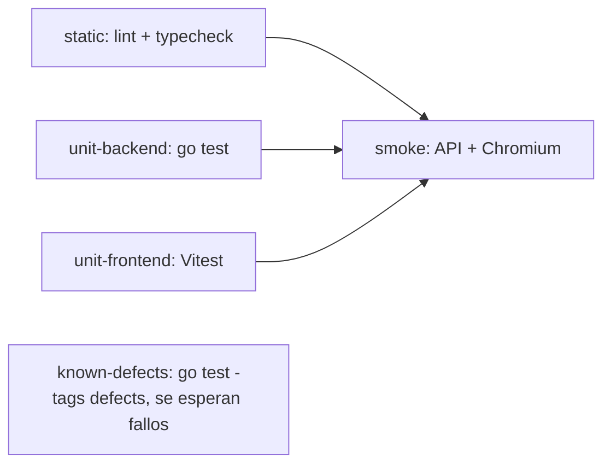
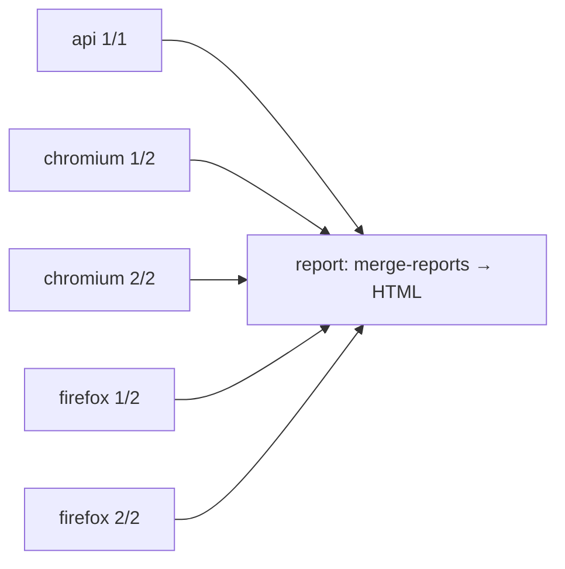

# EnergIA · Suite de Playwright

Automatización de la prueba técnica de QA: humo, flujo de negocio, API y defectos sobre la app levantada con Docker. Playwright + TypeScript.

## Requisitos

- Node 20 o superior (probado con Node 24).
- La app corriendo desde la raíz del repo: `docker compose up -d --build` (front en http://localhost:3000, API en http://localhost:8080).

## Instalar y correr

Una vez, para instalar dependencias y los navegadores:

```bash
cd e2e
npm run setup
```

Toda la suite, con un solo comando:

```bash
npm test
```

El reporte HTML queda en `playwright-report/`. Se abre con `npm run report`. Traza, captura y video se guardan solo de los tests que fallan.

Cada ejecución genera también resultados de **Allure** en `allure-results/`:

```bash
npm run report:allure        # genera allure-report/index.html, un solo archivo que se abre con doble clic
npm run report:allure:open   # lo sirve en el navegador
```

El reporte de Allure agrupa por suite y por etiqueta (`@smoke`, `@regression`, `@defect`), muestra pasos, adjuntos (trazas, capturas, videos en fallo) y el entorno (app, commit, zona horaria).

| Script | Qué corre |
|---|---|
| `npm test` | Todo: proyectos `setup`, `chromium`, `firefox` y `api` |
| `npm run test:smoke` | Solo `@smoke` (los casos de `qa/02-smoke.md`) |
| `npm run test:regression` | Solo `@regression` (flujo de negocio y tests por técnica de diseño) |
| `npm run test:defects` | Solo `@defect` (tests que evidencian defectos abiertos) |
| `npm run test:api` | Solo la API, sin navegador |
| `npm run test:ui` | Solo la UI, en Chromium y Firefox |
| `npm run lint` | ESLint con `eslint-plugin-playwright` |
| `npm run typecheck` | TypeScript estricto |

Para otro entorno, copia `.env.example` a `.env` y cambia `BASE_URL`, `API_URL` y las credenciales. Sin `.env` se usan los valores locales.

## Proyectos

| Proyecto | Navegador | Zona horaria / locale | Archivos |
|---|---|---|---|
| `setup` | Chromium | America/Bogota, es-CO | `tests/setup/*.setup.ts` |
| `chromium` | Desktop Chrome | America/Bogota, es-CO | `*.ui.spec.ts` |
| `firefox` | Desktop Firefox | America/Bogota, es-CO | `*.ui.spec.ts` |
| `api` | Ninguno | — | `*.api.spec.ts` |

La zona horaria es la de los operadores de planta (`America/Bogota`). Así los tests ven las horas como las ve un usuario real.

## Estructura

```text
e2e/
├── playwright.config.ts
├── src/
│   ├── config/env.ts            # URLs, credenciales, zona horaria, ruta del storageState
│   ├── data/                    # oracle.data.ts (valores esperados, cada uno cita su fuente) y las tablas de qa/03:
│   │                            #   partitions, boundaries, decision-table y pairwise (lee el .tsv de PICT de qa/)
│   ├── api/                     # energia.api.ts (cliente) y energia.types.ts (contrato)
│   ├── components/              # app-header, pagination, analysis-sheet
│   ├── pages/                   # login, dispatch, meter-ledger, meter-detail, anomalies, investigation
│   ├── utils/                   # format.ts (cifras es-CO desde el oráculo) y ordering.ts (orden monótono)
│   └── fixtures/test.ts         # test y expect con Page Objects y API autenticada
└── tests/
    ├── setup/auth.setup.ts      # login por UI una vez → .auth/operator.json
    ├── smoke/                   # @smoke
    ├── business/                # @regression: flujo del operador (libro → detalle → investigación de M-109)
    ├── api/                     # @regression: un spec por técnica (particiones, límites, decisión, prioridad, auth, pairwise)
    ├── defects/                 # @defect: un archivo por defecto, con test.fail()
    └── seed.ui.spec.ts          # punto de partida para los agentes de Playwright
```

## Etiquetas

| Etiqueta | Qué agrupa |
|---|---|
| `@smoke` | Los casos de humo de `qa/02-smoke.md` |
| `@regression` | El flujo de negocio y los tests de API por técnica de diseño. Deben pasar siempre |
| `@defect` | Un test por defecto abierto (BUG-01…BUG-05) que afirma el comportamiento documentado |

Cada test por técnica lleva el `TC-xx` de `qa/03-casos-caja-negra.md` en el título, y cada tabla de la caja negra es un arreglo en `src/data/` recorrido por un único test parametrizado: agregar una fila crea un test nuevo. Las 30 filas pairwise salen de `qa/evidencias/pairwise/getall.pict.out.tsv`; las filas cuya expectativa rompe BUG-01 o BUG-04 se marcan `test.fail()` y se calculan desde los datos.

## Defectos y `test.fail()`

Un test `@defect` afirma lo que la documentación dice, no lo que hace la app hoy. Lleva `test.fail()`, el `BUG-xx` en el título y la anotación `issue` con el enlace al reporte (`qa/05-defectos.md#bug-xx`).

- Con el defecto abierto, la aserción falla y Playwright lo cuenta como **esperado** (no rompe la suite).
- Cuando se corrige el defecto, la aserción pasa y Playwright lo reporta como **fallo inesperado**: hay que quitar `test.fail()` y el test queda como regresión.

Los tests de `@regression` no incluyen las aserciones afectadas por un defecto conocido; viven solo en `tests/defects/`. BUG-06 a BUG-09 quedan como casos manuales: `size` 0 y el estado en minúsculas no están en las tablas de límites ni de particiones.

## Pipelines

Hay dos workflows con funciones distintas. CI da feedback rápido en cada cambio, y Continuous Testing corre la suite completa en paralelo de forma programada.

### CI (`.github/workflows/ci.yml`)

Corre en cada `pull_request`, en cada `push` a `main` y a mano. Sigue la pirámide de pruebas: primero lo barato y rápido, la UI al final.



| Job | Qué hace | Bloquea |
|---|---|---|
| `static` | ESLint con `eslint-plugin-playwright` y TypeScript estricto | Sí |
| `unit-backend` | `go test -cover ./...` con la cobertura en el resumen del job | Sí |
| `unit-frontend` | `pnpm typecheck`, `pnpm lint` y `pnpm test`; los `*.defects.test.*` usan `it.fails` y siguen en verde | Sí |
| `known-defects` | `go test -tags defects`: queda en verde mientras los 6 tests `TestBUG*` sigan fallando (los defectos siguen abiertos) y se pone en rojo si uno empieza a pasar, porque ese defecto ya se corrigió y su test debe pasar a regresión. Es el mismo contrato que `test.fail()`. El resumen del job lista cada test | Sí, solo si un defecto se corrige sin promover su test |
| `smoke` | Levanta la app con Docker y corre `@smoke` en API y Chromium. Solo arranca si pasaron los tres anteriores | Sí |

### Continuous Testing (`.github/workflows/continuous-testing.yml`)

Corre todos los días a las 06:00 hora de Bogotá (`cron: 0 11 * * *`). También se puede lanzar a mano con la suite a elegir (`all`, `regression`, `defects`, `smoke`), y corre en los PR que modifican el propio workflow.



- **Paralelo:** una matriz de 5 jobs: API, y Chromium y Firefox partidos en 2 shards cada uno con `--shard`. Usa `fail-fast: false`, así que un shard roto no cancela los demás.
- **Aislado:** cada job corre en su propio runner con su propia app levantada con `docker compose`. No hay estado compartido entre jobs, y dentro de cada job los tests corren con `fullyParallel`.
- **Reportes consolidados:** cada shard sube su *blob report* y sus resultados de Allure. El job `report` une todo y publica dos artefactos: `continuous-testing-report` (Playwright HTML, con `merge-reports`) y `allure-report` (Allure en un solo `index.html`). En el resumen del run deja los conteos de esperados, inesperados, flaky y omitidos.

**Dónde ver los reportes:** en GitHub, Actions → *continuous-testing* → el run → sección **Artifacts** al final de la página. Se descarga el zip, se descomprime y se abre `index.html`. No se publican en GitHub Pages porque el repo es privado y Pages en repos privados requiere un plan de pago.

Para lanzarlo a mano:

```bash
gh workflow run continuous-testing.yml -f suite=all
```

## Reglas

- **Capas:** `tests → fixtures → pages/components/api → config/data`. Un test importa `test` y `expect` desde `src/fixtures/test`, nunca desde `@playwright/test`; el lint lo bloquea.
- **Sin locators en los tests:** los Page Objects exponen acciones y consultas (Locators), y las aserciones viven en el test.
- **Locators:** por rol y nombre accesible, label o texto. Hay dos XPath, cada uno con un comentario que explica por qué: son listas sin nombre accesible.
- **Sin esperas fijas:** solo aserciones web-first y `expect.poll`. `waitForTimeout`, `page.pause` y los locators crudos en tests son error de lint.
- **Login reutilizable:** el proyecto `setup` guarda la sesión con `storageState`. Solo los tests del login usan `NO_SESSION`.
- **Oráculo:** los valores esperados salen de `oracle.data.ts`, no de lo que devuelve la app.

Las convenciones completas (nombres de tests, commits, ramas) están en [`../CONVENTIONS.md`](../CONVENTIONS.md).

## Agentes de Playwright

`.mcp.json` en la raíz levanta el MCP `playwright-test` con esta configuración. Los agentes `playwright-test-planner`, `playwright-test-generator` y `playwright-test-healer` (`.claude/agents/`) parten de `tests/seed.ui.spec.ts`, que ya llega autenticado gracias a las fixtures.
